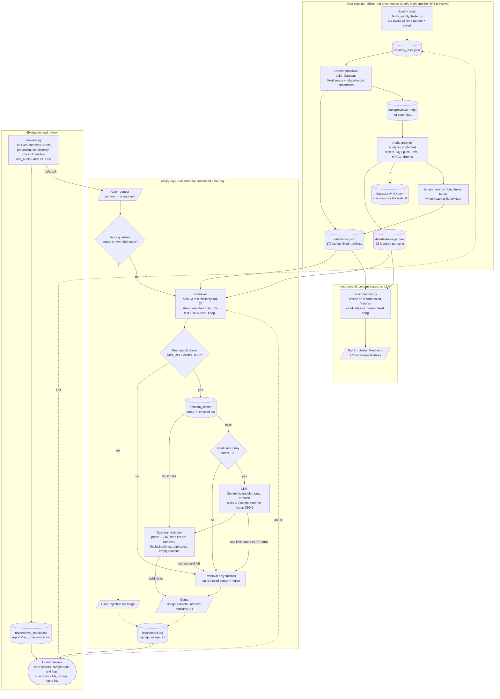

# Sonata

## Base Project

Sonata grows out of **VibeCheck 1.0 (Music Recommender Simulation)**, my project from Modules 1-3. VibeCheck was a purely content-based recommender. It scored each of 20 hand-made placeholder songs in `data/songs.csv` against a user profile: points for matching genre and mood, plus closeness in energy, valence and acousticness. It then returned the top 5 with a reason for every point. It also had switchable scoring modes (genre-first, mood-first and energy-focused) and an optional diversity penalty. It still runs unchanged with `python -m src.main`.

## Title and Summary

**Sonata: songs picked from your real taste, explained.**

Sonata replaces the placeholder songs with real music. It reads my Spotify listening history, finds each song on Deezer along with a related-artist candidate pool, and analyzes their 30-second previews with librosa. It has two ways to recommend:

- **`recommend`** is content-based. It ranks unheard songs by how close their audio features are to songs I already like, and says which liked song each one resembles and why.
- **`ask "<request>"`** is retrieval-augmented generation (RAG). It finds the songs in my library that best match a plain-language request, and an LLM (Google Gemini) picks 3-5 of them with a one-sentence reason each. Guardrails make sure it can only recommend songs that were actually retrieved, and the whole pipeline is measured by an evaluation script.

Both commands run from the committed data. They need no Spotify login, no MP3 files and no API key; without a key, `ask` uses mock mode or a retrieval-only fallback.

## Architecture Overview

The source is [diagrams/architecture.mmd](diagrams/architecture.mmd).



1. **Data pipeline** (run once, offline):
   - `sonata.fetch_spotify_taste` saves my top and saved Spotify tracks.
   - `sonata.build_library` finds each track on Deezer, downloads its preview and genre, and adds a pool of candidate songs from related artists.
   - `sonata.analyze` turns every preview into a 28-number feature vector, a star map (one star per note onset) for the planned web UI, and readable tempo, energy and brightness labels.
   - Everything except the MP3s is committed.
2. **Retriever:**
   - Each song gets a text description (title, artist, genre, labels and moods, hand-labeled or estimated), embedded with `all-MiniLM-L6-v2`.
   - A request retrieves the 24 closest descriptions. Songs with text similarity of 0.45 or more are strong matches and always rank first, scored 85% text similarity and 15% taste (audio similarity to my liked songs). Taste only reorders strong matches; weaker songs follow in text order. The best 8 go on.
   - With fewer than 3 strong matches, the model is told so and may return fewer songs, with a one-line note that the library has no strong match, instead of padding the list.
3. **LLM:** Gemini receives the request and only those 8 songs, and returns JSON picks with reasons. Responses are cached on disk, and real calls are capped at 18 a day.
4. **Guardrail validator:**
   - Checks the JSON and drops any song that wasn't retrieved, logging it as a hallucination.
   - Falls back to the top retrieved songs, with a notice, whenever the model fails or nothing valid is left.
5. **Evaluation and human review:**
   - `sonata.evaluate` runs fixed queries and writes the reports in `reports/`.
   - I read those reports, the sample runs and `logs/sonata.log` to decide what to tune.

## Setup Instructions

1. **Install** (Python 3.13):

   ```bash
   python -m venv .venv
   source .venv/bin/activate          # Windows: .venv\Scripts\activate
   pip install -r requirements.txt
   ```

2. **Configure (optional).** Without a `.env`, Sonata runs in mock mode and makes no API calls.

   ```bash
   cp .env.example .env
   ```

   To use Gemini, set `LLM_PROVIDER=gemini`, `LLM_MODEL` (a Gemini model name) and `GEMINI_API_KEY`. Real calls are capped at 18 a day and counted in `logs/api_usage.json`. Repeat requests are answered from `data/llm_cache/` for free.

3. **Run.** The first `ask` downloads the small MiniLM model from Hugging Face once and caches the song embeddings. After that it runs offline (except for Gemini calls).

   ```bash
   python -m sonata ask "upbeat songs for a night drive"   # RAG; add --no-audio for text-only ranking
   python -m sonata recommend                              # top 5 content-based picks; -k to change
   python -m sonata evaluate                               # evaluation summary, rewrites reports/
   python -m sonata.server                                 # galaxy and song skies at http://127.0.0.1:8000
   ```

   The home page is your **galaxy**: one star per song, laid out by UMAP so songs that sound alike sit close together. Liked songs are bright, the rest dim. Drag to pan, scroll or pinch to zoom, and hover for the title and artist.

   Orange stars are the five content-based recommendations, each joined by a thin line to the liked song it sounds closest to and listed in the **For you** panel. The **Ask Sonata** box runs the RAG pipeline: answers appear as cards with their reason and retrieval similarity, and their stars light up. The page uses the same functions as the CLI through `GET /api/recommendations` and `POST /api/ask`, so the same mock mode, cache and daily limit apply.

   Clicking a star dives into that song's **sky**: one star per note onset, placed by time and pitch and sized by loudness. Stars light up as the preview plays; without the MP3 previews, a scrub bar replaces playback. The ← Galaxy button, Escape or the browser's back button returns to the galaxy.

4. **Test.** All tests run in mock mode and never call the model.

   ```bash
   pytest
   ```

5. **Rebuild the data from your own taste (optional).** This needs Spotify app credentials in `.env`, with the redirect URI `http://127.0.0.1:8888/callback` registered for your app.

   ```bash
   python -m sonata.fetch_spotify_taste   # opens a browser to log in; writes data/my_taste.json
   python -m sonata.build_library         # Deezer search + previews; writes data/library.json
   python -m sonata.analyze               # writes data/features.parquet, data/stars/, labels
   python -m sonata.compute_galaxy        # UMAP layout: writes x, y per song into data/library.json
   ```

6. **Label moods (optional, no credentials needed).** Tag songs one at a time with moods from a fixed list (chill, focus, hype, party, sad, romantic, dark, uplifting, workout, late-night). Liked songs come first, Enter skips, `q` saves and quits, and the next run resumes where you stopped.

   ```bash
   python -m sonata.label                   # writes data/mood_labels.csv, then refreshes the embeddings
   python -m sonata.label --revisit-skipped # go back through skipped songs
   ```

   Labeled songs get "Moods: …" in their description. Unlabeled songs get "Moods (estimated): …", keeping each mood that at least 3 of their 5 most similar-sounding labeled songs share.

7. **Label the rest with the agent (optional, uses Gemini).** `sonata.label_agent` labels every song without a hand label: Gemini labels batches of 25 using 15 of my hand labels as examples, rule-based checks flag doubtful labels (contradictory moods, low confidence, numbers far outside my own labels' range for that mood, moods that the nearest labeled songs don't share), and flagged songs go back to the model with the evidence. What's still flagged waits for me in `sonata.review`.

   ```bash
   python -m sonata.label_agent --plan   # calls needed and already cached; makes no calls
   python -m sonata.label_agent          # writes data/auto_labels.json and reports/label_eval.md
   python -m sonata.review               # accept or replace the flagged labels (saved as hand labels)
   ```

   A full run needs more than one day's 18 calls. When the budget runs out it stops and writes nothing; running it again the next day replays the finished batches from the cache for free. In mock mode its outputs go to `logs/mock_label_agent/` instead. Hand labels always win over agent labels.

The original VibeCheck recommender still runs with `python -m src.main`.

## Sample Interactions

These runs are from [assets/sample_runs.txt](assets/sample_runs.txt). They were produced from a clean copy of the committed files, with no `.env`, so the provider is `mock`. Retrieval, guardrails and confidence scores are real; the reasons are canned text built from each song's data. ♥ marks a song already in my liked songs.

```
$ python -m sonata ask 'high energy reggaeton for a party'

INFO Embedding 379 new song descriptions

Source: mock

1. 2 K 1 6 by Omar Courtz  (confidence 0.68)
   [mock] 2 K 1 6 is Reggaeton with low energy, matching 'high energy reggaeton for a party'.

2. Q U E V A S H A C E R H O Y ? by Omar Courtz ♥  (confidence 0.66)
   [mock] Q U E V A S H A C E R H O Y ? is Reggaeton with medium energy, matching 'high energy reggaeton for a party'.

3. Weeknd<3 by legallyrxx  (confidence 0.65)
   [mock] Weeknd<3 is Reggaeton with low energy, matching 'high energy reggaeton for a party'.
```

```
$ python -m sonata ask 'sad slow songs for a rainy night'

Source: mock

1. Hours In Silence by Drake ♥  (confidence 0.62)
   [mock] Hours In Silence is Rap/Hip Hop with high energy, matching 'sad slow songs for a rainy night'.

2. underwater by FRANKIEONTHEGUITAR ♥  (confidence 0.59)
   [mock] underwater is Pop with medium energy, matching 'sad slow songs for a rainy night'.

3. Drama (feat. Drake) by Roy Woods  (confidence 0.58)
   [mock] Drama (feat. Drake) is R&B with low energy, matching 'sad slow songs for a rainy night'.
```

```
$ python -m sonata ask 'dark rap for the gym'

Source: mock

1. Hours In Silence by Drake ♥  (confidence 0.68)
   [mock] Hours In Silence is Rap/Hip Hop with high energy, matching 'dark rap for the gym'.

2. redrum by 21 Savage  (confidence 0.68)
   [mock] redrum is Rap/Hip Hop with high energy, matching 'dark rap for the gym'.

3. 4 Raws by EsDeeKid ♥  (confidence 0.68)
   [mock] 4 Raws is Rap/Hip Hop with high energy, matching 'dark rap for the gym'.
```

## Design Decisions

- **Spotify for taste, Deezer for audio.** Spotify gives an honest picture of what I listen to but no longer provides previews or audio features to new apps. Deezer's public API has 30-second previews, genres and related artists with no login. Matches must agree on the artist (similarity 0.85 or higher) before the title is compared, because title-only matches picked lullaby covers.
- **My own audio features instead of Spotify's.** librosa computes tempo, loudness, brightness, 13 MFCCs (timbre) and 12 chroma values (harmony) for every preview.
  - Tempo labels use fixed BPM cut-offs: below 90 is slow, 120 and above is fast.
  - Energy and brightness labels are thirds of my library, because loudness depends on mastering. "High energy" therefore means loud *for my songs*.
- **Cosine similarity on standardized features** for `recommend`. Z-scoring puts BPM and 0-1 chroma values on the same scale. Each candidate is scored against its *closest* liked song, not my average taste, so a mixed taste (reggaeton plus indie) isn't blurred into a middle that matches nothing. The per-feature terms of the cosine explain each match.
- **The LLM never chooses from the whole catalog.** Retrieval narrows the library to 8 songs first, and the model may only pick from those. This keeps prompts small, makes every pick checkable, and makes a hallucinated song easy to detect and drop.
- **A relevance gate before the model.** If the best text match is below 0.40, Sonata skips the model and returns the closest songs with a notice that they're weak matches. I set the threshold from real data: real requests scored 0.47-0.76, nonsense 0.12-0.34.
- **Built around a free tier of about 20 requests a day:**
  - A disk cache keyed by the query, the retrieved IDs, the model and the prompt version, so repeating a request costs nothing.
  - A daily cap of 18 calls, counted *before* each call.
  - Mock mode by default for development and every test.
  - SDK retries and automatic function calling turned off, so one `ask` is at most one request.
  - Any quota, rate-limit or network error becomes the retrieval-only fallback, never a crash.
- **Retrieval similarity, not "confidence".** Each pick carries `retrieval_similarity`: how closely it matched the request in retrieval. It was called "confidence", which suggested a chance of being right; it isn't one. LLMs are poorly calibrated about their own certainty, so the score comes from retrieval instead: it's reproducible and means the same thing whether the answer came from Gemini, the cache or the fallback.
- **Relevance first, taste second.** The request decides which songs are candidates. Taste (15%) only breaks ties among strong matches, so a song that sounds like my favorites can't outrank one that actually fits the request.
- **The commands work from committed data.** Shared constants live in the lightweight `sonata/features.py`, so `ask`, `recommend` and `evaluate` never import librosa or spotipy.

## Testing Summary

**Unit tests: 79 passing** (`pytest`). They cover:

- Deezer matching, against the cover-version and remaster cases found in real data.
- Audio analysis on synthetic notes with known pitches and onsets.
- Feature standardization and the cosine recommender.
- Retrieval and audio blending, with a fake offline embedder.
- The validator: hallucinated, duplicate and malformed IDs, and bad JSON.
- Cache, quota and 429 handling, against a fake Gemini SDK.
- The evaluation metrics and the CLI.

A shared fixture makes any real Gemini call inside a test raise an error.

**RAG evaluation** (`python -m sonata evaluate`, from [reports/eval_results.md](reports/eval_results.md)):

| # | Query | Kind | Grounding | Consistency | Graceful | Avg confidence | Sources |
|---|---|---|---|---|---|---|---|
| 1 | high energy reggaeton for a party | normal | ✅ pass | ✅ pass (100%) | ✅ pass | 0.67 | mock |
| 2 | chill songs to study to | normal | ✅ pass | ✅ pass (100%) | ✅ pass | 0.53 | mock |
| 3 | sad slow songs for a rainy night | normal | ✅ pass | ✅ pass (100%) | ✅ pass | 0.60 | mock |
| 4 | dark rap for the gym | normal | ✅ pass | ✅ pass (100%) | ✅ pass | 0.68 | mock |
| 5 | songs like Bad Bunny | normal | ✅ pass | ✅ pass (100%) | ✅ pass | 0.63 | mock |
| 6 | bright happy pop | normal | ✅ pass | ✅ pass (100%) | ✅ pass | 0.52 | mock |
| 7 | music for a late night drive | normal | ✅ pass | ✅ pass (100%) | ✅ pass | 0.60 | mock |
| 8 | *(empty)* | bad_input | ✅ pass | ✅ pass (100%) | ✅ pass | — | rejected |
| 9 | asdkjh qwpoeiru zzxv | nonsense | ✅ pass | ✅ pass (100%) | ✅ pass | 0.38 | fallback |
| 10 | play something play something play so… (599 chars) | bad_input | ✅ pass | ✅ pass (100%) | ✅ pass | — | rejected |
| | **Total** | | **10/10** | **10/10** | **10/10** | **0.57** | |

What the checks mean:

- **Grounding:** every recommended song was in that run's retrieved set.
- **Consistency:** the recommended songs overlap by at least 60% across the 3 runs.
- **Graceful:** bad input is rejected with a message, and nonsense gets a weak-match notice instead of a model answer.

The validator dropped 0 hallucinated songs.

These results come from the mock provider, so consistency is 100% by construction. `python -m sonata evaluate --fresh` measures Gemini's real run-to-run consistency, but it needs more calls than one day's cap allows.

## RAG Enhancement

**Audio re-ranking.** Retrieval originally ranked songs by text similarity alone. The enhancement re-ranks the top 24 text matches with audio similarity to my closest liked song, favoring songs that both fit the words and *sound* like what I already listen to. It started as a 70% text / 30% audio blend; it's now 85% / 15%, applied only among strong matches, after the 30% let taste push songs that didn't fit the request (like loud rap for "chill songs to study to") to the top. The tables and sample runs in this README were measured with the earlier 70/30 version and its "confidence" naming; rerun `python -m sonata evaluate` to refresh them. The before/after below is from [reports/rag_comparison.md](reports/rag_comparison.md): `use_audio=False` before, `use_audio=True` after.

| # | Query | Before: picks | After: picks | Overlap | Confidence before → after | Audio match before → after | ♥ before → after |
|---|---|---|---|---|---|---|---|
| 1 | high energy reggaeton for a p… (33 chars) | Weeknd<3 — legallyrxx<br>BAKANO — legallyrxx<br>RIGHT NOW — Lucho RK | 2 K 1 6 — Omar Courtz<br>Q U E V A S H A C E R H O Y ? — Omar Courtz ♥<br>Weeknd<3 — legallyrxx | 20% | 0.65 → 0.67 | 0.63 → 0.72 | 0 → 1 |
| 2 | chill songs to study to | Did It First — Ice Spice ♥<br>Rein Me In — Sam Fender ♥<br>Scared — Russ ♥ | Did It First — Ice Spice ♥<br>Help Me Lose My Mind — Disclosure<br>Sin Frenos — Eladio Carrion ♥ | 20% | 0.45 → 0.53 | 0.64 → 0.72 | 3 → 2 |
| 3 | sad slow songs for a rainy ni… (32 chars) | Nights — Frank Ocean ♥<br>the cure — Olivia Rodrigo<br>NO CRY — Kapo ♥ | Hours In Silence — Drake ♥<br>underwater — FRANKIEONTHEGUITAR ♥<br>Drama (feat. Drake) — Roy Woods | 0% | 0.52 → 0.60 | 0.59 → 0.84 | 2 → 2 |
| 4 | dark rap for the gym | Runnin — 21 Savage<br>Scared — Russ ♥<br>Redbone — Childish Gambino | Hours In Silence — Drake ♥<br>redrum — 21 Savage<br>4 Raws — EsDeeKid ♥ | 0% | 0.62 → 0.68 | 0.61 → 0.88 | 1 → 2 |
| 5 | songs like Bad Bunny | Party — Bad Bunny ♥<br>Moscow Mule — Bad Bunny ♥<br>Agosto — Bad Bunny ♥ | Andrea — Bad Bunny ♥<br>Efecto — Bad Bunny ♥<br>Party — Bad Bunny ♥ | 20% | 0.57 → 0.63 | 0.68 → 0.79 | 3 → 3 |
| 6 | bright happy pop | LEGACY — PIXY ♥<br>Ella — Mishnrz ♥<br>Shiny — Easykid ♥ | LEGACY — PIXY ♥<br>la culpa (track 11) — alleh ♥<br>Antagonista — NSQK ♥ | 20% | 0.45 → 0.52 | 0.64 → 0.77 | 3 → 3 |
| 7 | music for a late night drive | Nights — Frank Ocean ♥<br>Blind — OVI WOOD<br>Late Night Talking — Harry Styles ♥ | Static — Steve Lacy ♥<br>This Is America — Childish Gambino<br>JACKIE BROWN — Brent Faiyaz ♥ | 0% | 0.53 → 0.60 | 0.68 → 0.83 | 2 → 2 |
| 8 | *(empty)* | *rejected* | *rejected* | 100% | — → — | — → — | 0 → 0 |
| 9 | asdkjh qwpoeiru zzxv | Tu No Vive Asi (feat. Mambo Kingz & DJ Luian) — Arcángel<br>ZABKA — Azzfit<br>RANA POSTRZALOWA — Azzfit<br>Mopao aye (feat. MC YOSHI, Mauvais Djo & Kokosvoice) — TRIANGLE DES BERMUDES<br>7 Lágrimas (Remix) — Soge Culebra | ZABKA — Azzfit<br>Tu No Vive Asi (feat. Mambo Kingz & DJ Luian) — Arcángel<br>RANA POSTRZALOWA — Azzfit<br>Cmon (LATIN MAFIA & Fred edit) — Fred again.. ♥<br>Q U E V A S H A C E R H O Y ? — Omar Courtz ♥ | 43% | 0.22 → 0.38 | 0.75 → 0.80 | 0 → 2 |
| 10 | play something play something… (599 chars) | *rejected* | *rejected* | 100% | — → — | — → — | 0 → 0 |

**Averages over the 8 queries that returned songs:** overlap 15%, confidence 0.50 → 0.57, audio match 0.65 → 0.79, liked songs per answer 1.8 → 2.1.

*Audio match* is the picks' average audio similarity to their closest liked song. Confidence is each column's own ranking score (text only before, the blend after), so the two confidence numbers are not on exactly the same scale.

**What changed:** with audio re-ranking, the picks sound much more like my liked songs (audio match 0.65 → 0.79), and the answers change a lot (only 15% overlap). The re-ranking also has a cost, which shows in query 3: "sad slow songs for a rainy night" swaps Frank Ocean's "Nights" for Drake's high-energy "Hours In Silence". The audio term rewards sounding like *my* taste, which can override the mood the request asked for.

## Reflection
